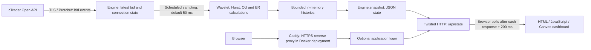

# Quant Engine

A Python dashboard for exploring live market data from cTrader with wavelet filtering and short-window statistical diagnostics. It displays raw and filtered prices, a Hurst-based regime classification, and estimates of mean-reversion behaviour in the browser. It is all hosted on my self-hosted Kubernetes Cluster.

The project is read-only: it subscribes to market prices and does not submit orders. I use merely as a tool for analysis and learning.

## Why this project exists

The question behind this project is how to make changes in a price series easier to inspect while keeping the underlying data visible. A filtered curve can help show structure, but it can also hide information. For that reason, the dashboard shows the raw bid alongside the filtered series and reports several diagnostics instead of reducing everything to a buy or sell signal.

The project brings together numerical methods, an asynchronous broker connection, a small HTTP API, and a browser interface. Its useful output is a view of the current price path and the assumptions behind its interpretation. It does not establish whether a strategy would be profitable. It adds just one more confluence.

## Architecture

For the architecture we use a very simple approach. The application uses a single Python process. Twisted handles the broker connection, scheduled calculations, and HTTP requests through its reactor event loop. There is no separate API service, database, or frontend build step. Price histories live in bounded in-memory buffers and reset when the process restarts; OAuth tokens are persisted separately.

### Main files

| File or directory | Responsibility |
| --- | --- |
| `live_quant_engine.py` | Broker client, numerical functions, engine state, snapshots, and HTTP server |
| `dashboard_auth.py` | Password verification, expiring server-side sessions, login and logout |
| `web/index.html` | Dashboard layout, JSON polling, and Canvas charts |
| `web/login.html` | Login form |
| `Generating_Keys/get_token.py` | OAuth authorization, token import, account listing, and app-login diagnostics |
| `tests/` | Unit tests for calculations, broker-message handling, OAuth helpers, and HTTP authentication |
| `scripts/` | Local setup, password hashing, clean export, and SDK wheel reproduction |
| `vendor/` | cTrader SDK wheel with locally adjusted dependency metadata and upstream license |
| `Dockerfile`, `compose.yaml`, `deploy/` | Container runtime, reverse proxy, and deployment instructions |

Python 3.12 is used with NumPy, PyWavelets, Twisted, and the cTrader Open API SDK. The frontend uses plain HTML, CSS, and JavaScript.

## What the dashboard calculates

| Measurement | Implementation | Interpretation |
| --- | --- | --- |
| Filtered price | Level-3 stationary wavelet transform with `sym4` over 64 samples; soft-threshold detail coefficients with `std(detail) * sqrt(2 * log(64))`, then reconstruct and retain the last value | A locally smoothed view of the bid; not a prediction |
| Hurst estimate | On 100 raw samples, regress `log(sqrt(std(x[t+lag] - x[t])))` against `log(lag)` for lags 2–19; multiply the slope by two and clip to `[0, 1]` | A short-window estimate used for the regime label |
| Legacy OU λ | Regress price increments against the preceding price over 50 samples; report `max(-slope, 0)` | A reversion coefficient per sample step, without converting to seconds |
| Additional OU fit | Fit `x[t+1] = a + phi*x[t] + error` on 50 actual samples; accept the standard OU mapping only for `0 < phi < 1` | Model equilibrium, reversion rate per second, half-life, and residual-based z-score |
| Efficiency ratio (ER) | `abs(last - first) / sum(abs(diff(prices)))` on up to 100 actual samples | Net displacement relative to total path length; no direction sign |
| Market noise | Mean absolute difference between raw and filtered values over 20 samples | Filter residual magnitude in price units, rather than return volatility |

Raw and filtered buffers hold 256 samples; the price chart displays the latest 100. Noise, Hurst, and legacy OU histories retain 60 values. At initialization, price buffers are padded with the first bid. The additional ER and OU diagnostics use actual sampled observations, and the interface waits for 100 actual samples plus price variation before displaying an active regime interpretation.

### Regime classification

Only Hurst determines the regime. ER and the additional OU fit provide context and do not override it.

| Hurst value with default thresholds | Display | Meaning under this rule |
| --- | --- | --- |
| `H > 0.6` | Blue, `TRENDING` | Persistence; does not specify whether prices rise or fall |
| `H < 0.4` | Purple, `MEAN REVERTING` | Antipersistence; does not prove a stationary equilibrium |
| `0.4 <= H <= 0.6` | Amber, `RANDOM WALK` | Neutral band in the implemented rule; not a statistical test for a random walk |
| Warming up, unavailable feed, or constant prices | Grey / inactive interpretation | Insufficient usable data for the displayed interpretation |

The confidence value is the implemented distance score: `200 * abs(H - 0.5)`, clipped to 0–100 in the two active regimes, and zero in the neutral band. It is not a calibrated probability of a successful trade.

For the additional OU fit, `kappa = -log(phi) / dt`, `mu = a / (1 - phi)`, and `half_life_seconds = log(2) / kappa`. Its z-score expresses the latest price's distance from the fitted equilibrium in units of the estimated stationary scale. Invalid fits do not report an equilibrium or half-life. A constant ER window is assigned zero.
